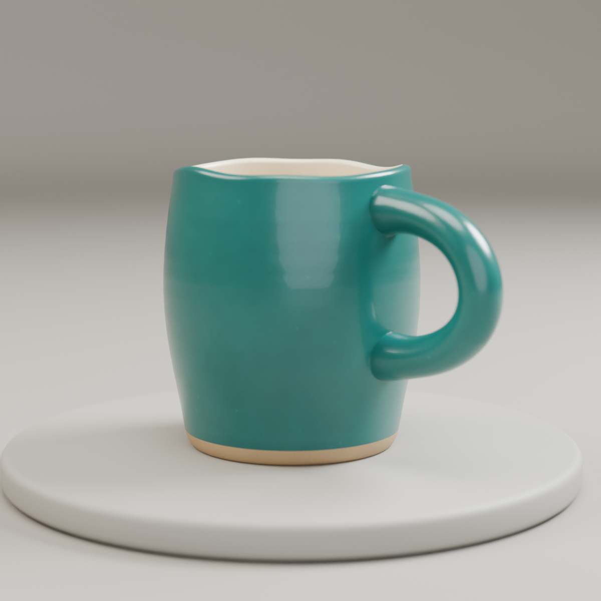
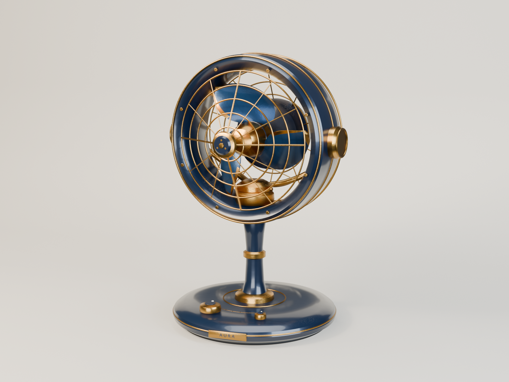
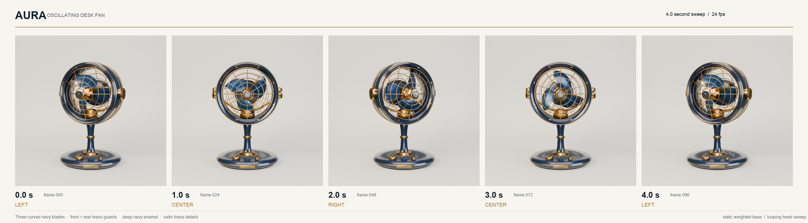

# dev.19 real-task examples

Two autonomous runs on 2026-10-27 using dsh-3d 0.2.3-dev.19, the `dsh-3d-modeler` preset, DeepSeek `deepseek-flash` with high reasoning effort, and Blender 5.2.2 LTS. The installed plugin and skill stayed unchanged during both runs. Each session received one task prompt; the agent selected its construction and inspection methods.

## Ceramic mug — product modeling and export

[Prompt](ceramic/prompt.txt) · [Editable scene](ceramic/handmade_ceramic_mug.blend) · [GLB](ceramic/handmade_ceramic_mug.glb) · [Top view](ceramic/ceramic_mug_top.png) · [Tool timeline](ceramic/tool-timeline.json)

143 tool calls, 8 error results, approximately 44.3 minutes wall time. The agent loaded the main skill, read operation notes, created texture and scene scripts, inspected renders and crops, repaired geometry/material/lighting issues, and used export validation, reimport and preview tools. The final task completed. The handle attachment retains some visible surface irregularity; the scene remains suitable for further refinement.

The GLB contains the mug with UVs, materials and embedded base-color textures. Procedural Blender shader microdetail stays in the Blender scene. The saved scene contains the studio, cameras, lights and packed textures.

## Desk fan — assembly and animation

[Prompt](fan/prompt.txt) · [Editable animation](fan/AURA_Desk_Fan.blend) · [Tool timeline](fan/tool-timeline.json)

110 tool calls, 5 error results, approximately 29.2 minutes wall time. The agent loaded the main skill, discovered helpers, inspected several camera views and image crops, repaired API and geometry issues, sampled animation frames and delivered a five-frame contact sheet. The final task completed.

An independent Blender read of the final scene verified 112 objects, 24 fps, frame range 0–96, changing head/rotor angles and an unchanged base world transform at frames 0, 24, 48, 72 and 96. See [the independent check](fan-independent-check.json). This check covers sampled transforms; continuous collision clearance remains unverified.

## What these runs establish

- Both agents discovered the main skill and completed observation/correction/delivery cycles, with recovery after tool errors.
- Both used Python for geometry. Native brush calls were zero. These runs provide evidence for code editing, rendering, asset delivery and animation.
- Local scene edits and full-script rebuilds were mixed. The model-authored mug builder calls `read_factory_settings(use_empty=True)`; the fan builder calls its own `clear_scene()`. The agents also successfully edited existing scene data through the same runtime.
- Reusable code was actively revised: the mug builder was invoked through `tool_path` 15 times and the fan builder 9 times. Some invocations failed and were subsequently repaired. These counts describe script calls, not successful rebuild counts.
- The shared scene supports persistence. A monolithic project script makes replaying construction convenient; existing local edits then need to be reflected in that script to survive another rebuild. That is an interaction between the agent's script organization and the unrestricted execution interface. These two runs provide observational evidence; causal attribution would require a controlled comparison.

## Files and reuse

Open the saved `.blend` files to inspect the actual delivered states. Model-authored source snapshots are included: [mug builder](ceramic/tools/build_mug.py), [texture generator](ceramic/tools/make_textures.py), and [fan builder](fan/fan_build.py). Inline scene edits made later in the sessions can differ from these script snapshots. Exact replay of the final scene from these scripts has not been verified.

The mug builder expects the dsh `workspace` global and generated textures in `textures/`; its texture generator uses NumPy, Pillow and SciPy. These builders recreate scene contents, so execute them in a fresh working scene.

Publication copies have image metadata and local scene paths cleaned, with geometry, animation and image pixels retained. Raw session logs and private environment details remain local. The compact timelines contain tool names, operation categories and error flags. [results.json](results.json) contains call counts and wall times. Error counts include model-authored code/API errors and interface/context errors; they are not plugin-defect counts. Both are text-to-3D tasks; the reference reconstruction reviewer was outside their task scope.

The examples follow the repository's MIT license. They are illustrative results from individual runs, with human visual inspection after completion.
