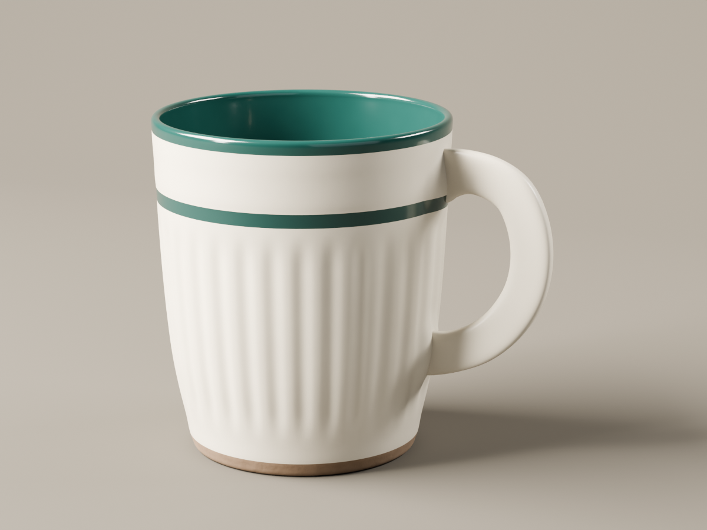
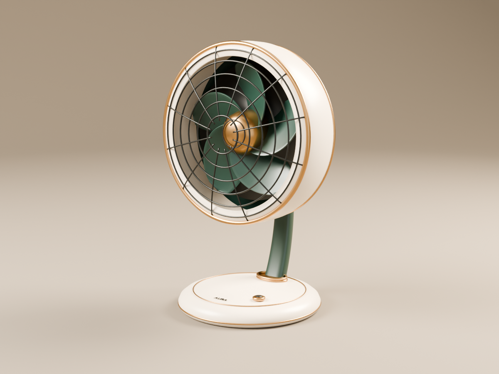

# DSH 3D dev.20 product showcase

Two independent text-to-3D sessions generated a ceramic cup and a desk fan for the project README. Both used dsh-3d `0.2.3-dev.20`, the `dsh-3d-code-modeler` preset and DeepSeek `deepseek-flash` with high reasoning effort. The sessions ran on 2026-10-28–29 (Asia/Shanghai).

The agents chose the designs and modeling methods, built the geometry and materials, inspected renders, and adjusted the results. Both used Python construction and Blender rendering. These images are the delivered 1200 × 900 Blender renders.

## MERIDIAN ceramic cup

[Original task](cup-prompt.txt)

The cup combines a fluted ivory body, green inner glaze and rim, a curved handle and a clay-colored foot.

## AURA desk fan

[Original task](fan-prompt.txt)

The fan combines a cream housing, green blades and stand, a metal grille and brass-colored accents. The scene includes the base, controls, support, head and rear housing.
